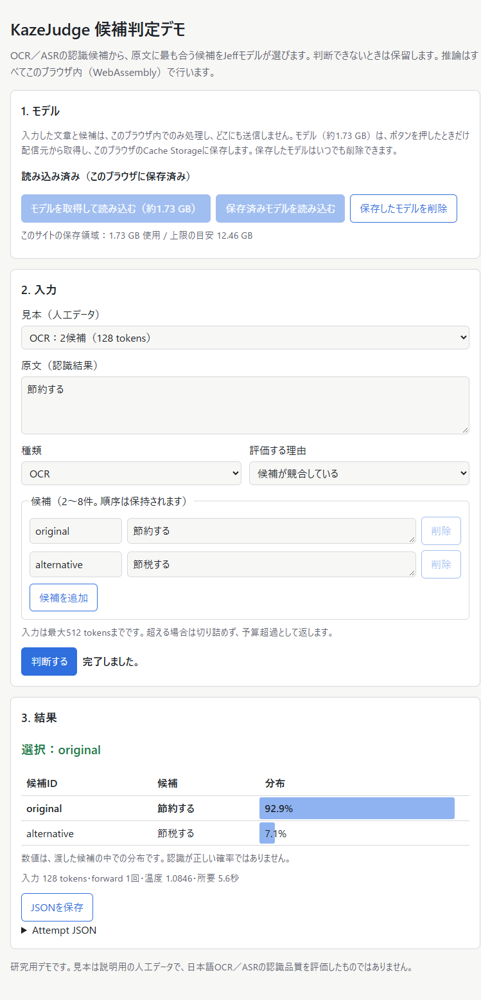

# Webデモ W3の結果

2026-10-11。[Wasm成立性計画](wasm-demo-feasibility-plan.md)のW3。**`apps/web-demo/`の静的Webデモが、Chrome 153とEdge 153で事前登録した全条件に合格した。** 利用者はブラウザだけで、モデルの取得・保存・削除、入力、判断、取消、JSON保存まで操作できる。推論中もUIは止まらず、画面の通信・保存の説明と実際の通信が一致した。headlessでの自動確認であり、公開（W4）はまだ行っていない。既存Native source・凍結exe・Decision Reportは変更していない。

## できること

- **モデル**：「モデルを取得して読み込む（約1.73 GB）」を押したときだけ取得し、ブラウザのCache Storageに保存する。次回からは「保存済みモデルを読み込む」で通信なしに使える。「保存したモデルを削除」で消せる。進捗の表示と中止に対応。
- **入力**：原文、OCR／ASR、評価する理由、候補2〜8件（順序を保持）。人工データの見本7件から選んで入力欄へ反映できる。
- **結果**：選択または保留、候補ごとの分布、token数と所要時間、`Attempt` JSONの表示と保存。分布は認識の正解率ではないと画面に明記した。
- **失敗の扱い**：512 tokens超は切り詰めず「予算超過」として返す。理由「なし」はモデルを呼ばない。候補IDの重複などは送信前に画面で止める。失敗は判断として扱わない。
- **取消**：推論中の「取消」でWorkerを破棄し、保存済みモデルから自動で読み込み直す。

## 判定（Chrome／Edge共通）

| 条件 | 結果 |
| --- | --- |
| 取得の同意 | ボタンを押す前に`model/`への要求は0件 |
| 取得は1回 | 5ファイルとも、セッション全体でサーバーからの取得は1回だけ。取消後の再読込とページ再読込はCache Storageから読んだ |
| 入力を送らない | 7回の判断の間、ページとWorkerの通信要求は0件。全要求がデモ自身のoriginあて |
| 判断の一致 | 見本0／2／5（128／206／512 tokens、2／3／8候補）が公式参照と一致。確率差は最大2.4e-6（基準1e-4）。prompt hash・候補順・判断・token数も一致 |
| 失敗系 | 874 tokensは`failed: budget_exceeded`（provider呼出1回）。理由なしは`not_selected`（呼出0回）。ID重複は画面で拒否 |
| Attempt | `kaze_judge.attempt.v1`。artifactsにcheckpoint 11ファイル、`bundle_manifest`、`wasm_engine`（配信したwasmのhash）、`prompt`、`rendered_prompt`、`policy`を含む。ブラウザが取得して照合するのは、推論に使う4ファイルとmanifestだけ。残り7ファイル（LICENSE等）のhashは、照合済みmanifestの記録をそのまま載せている |
| JSON保存 | 保存されたファイルは表示中のAttemptと同一。fieldの順序もcoreの`Attempt`と同じ |
| 反復 | 取消後と再読込後の判断は、最初の判断とbit単位で一致 |
| UIが止まらない | 推論中のmain threadのtimer間隔は最大72 ms（基準250 ms） |
| 削除 | 削除後に`kazejudge-model-*`のcacheが残らず、再読込で「未取得」と表示 |

## 構成

- **エンジン**（[engine](../apps/web-demo/engine)）：Native `RustProvider`と同じ手順（資産のhash、decision config、tokenizer、prompt、全層forward、readout、policy、artifacts）と、core `evaluate`と同じ`Attempt`の意味をWasmで実行する。演算はW1／W2で検証済みのprobe（凍結sourceから生成したコピー）を再利用した。違いは2点ある。期限はページ側がWorkerの破棄で管理すること。artifactsのNative `runtime_build`を`wasm_engine`に置き換えたこと。
- **core**：`Observation::validate_within`を追加した。`validate`と同じ検査を期限なしで行い、`Instant`がないブラウザで使う。`validate`はこれを呼ぶ形にしただけで、既存の挙動は変えていない（契約試験を追加）。
- **hashの計算**：資産がstreamでメモリに入る間に、エンジンが順にSHA-256を計算する。session open時にmanifestと照合し、未完了の資産だけはその場で計算する。W2で4.7〜15秒かかったopen時のhashは約1 msになった（同じ検証を、取得と同時に行う形）。
- **配信物**：`build_demo.py`が、ページ、Worker、エンジン、設定（資産のbytesとSHA-256、cache名、上限512 tokens）、見本を出力する。モデルは`model/`に置く。`--copy-model`で出力へ複製する。

## 時間（単発の観測値）

性能の判定ではない。127.0.0.1から配信した。

| 処理 | Chrome | Edge |
| --- | ---: | ---: |
| 取得＋検証＋準備（1.73 GB） | 9.9秒 | 11.0秒 |
| 保存済みからの読込＋準備 | 5.5秒 | 5.5秒 |
| 判断：128 tokens | 5.4〜5.7秒 | 5.5〜5.8秒 |
| 判断：206 tokens | 8.3秒 | 8.7秒 |
| 判断：512 tokens | 20.5秒 | 20.6秒 |

実際の配信では、取得時間は回線速度に依存する。

## 確認中に見つけて直した不具合

開発時と最終確認の途中で、次を修正した。最初の最終確認（commit `a280fdc`）は、2.の不具合で`results`条件に**不合格**となった。この記録は残し（`failed-a280fdc/`）、修正後のcommit `5991887`で両browserを再測定した。

1. 状態確認の`caches.open`が、削除直後に空のcacheを作り直していた → 先に`caches.has`で存在を確認する。
2. 候補の文字列欄が`<input>`で、改行を黙って消していた（asr-unicodeの見本で検出）→ `<textarea>`に変更。入力を変えないという原則に関わるため、E2Eで検出できた意味が大きい。
3. CSSの`display`が`hidden`属性より優先され、空の進捗barが表示されていた → `[hidden]`を常に非表示にする。
4. 保存JSONのfield順が辞書順になっていた → `Attempt`を直接serializeして順序を保持。
5. 不要な`favicon.ico`への要求 → 埋め込みのiconを指定。

## W4（公開）へ持ち越す事項

- **公開先と配布条件**：自プロジェクトのlicense、モデル・派生資産・依存のNOTICE、1.73 GBの配信容量と費用、HTTPSの静的hostingを決める。公開は配布条件の確認後に行う。
- **不要なexport**：エンジンのwasmには、依存先のprobeの開発用関数（`kj_*`）もexportされている（ページは使わない）。公開前に除去方法を決める。probeのbinaryはW0〜W2の証跡に固定しているため、今回は変更していない。
- **表示の細部**：失敗時にも「数値は候補内の分布」の注記が表示される。保存領域の使用量表示は、削除直後にはすぐ減らない（ブラウザの見積もりの更新が遅れる）。
- **環境**：headless・Windows・Chrome／Edgeのみ。headed表示、Firefox／Safari、モバイル、メモリの少ない端末、HTTPS上の実配信は未確認。
- **範囲**：512 tokensまで。対応範囲外の入力は予算超過で返す。

## 使い方・証跡

[apps/web-demo/README.md](../apps/web-demo/README.md)、[証跡](research/wasm-demo/w3-2026-10-11/README.md)。
