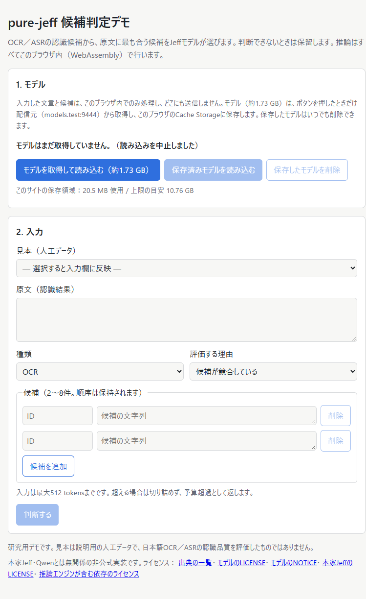

# Webデモ W4（公開準備）の結果

2026-10-11。Webデモを公開できる状態に近づけるため、配信物の整理と表示の修正を行い、HTTPSと別originのモデル配信を模した環境で、Chrome 153とEdge 153のE2Eを実施した。**全条件に合格した。実際の公開、Cloudflareの設定、remote作成は行っていない。** 配信構成と料金は[W4 hosting](w4-hosting.md)にある。

## 変更（commit `a496261`）

- **開発用exportの除去**：engineはWasm probeをlibraryとして使うため、probeの開発用関数（`kj_*`）までexportされていた。buildの後処理（`strip_exports.py`）でexport sectionだけを書き換え、`memory`と`demo_*`だけを残した。13個を除去し、codeとほかのsectionは変えていない。probeのsourceと証跡も変えていない。
- **ライセンスの同梱**：配信物に`licenses/`を加えた。engineに含まれる依存130 packageのライセンス本文、checkpointの`LICENSE`と`NOTICE`、本家JeffのMIT license、出典の一覧を含む。ページの末尾にリンクと、非公式実装である旨を表示する。
- **表示**：名称をpure-jeffにした。モデルの配信元のhostを表示する。失敗や不評価のときは分布の注記を出さない。削除直後の使用量表示が遅れる旨を説明する。
- **別originからのモデル取得**：`--model-base-url`で、モデルを別origin（R2など）から取得するbuildを作れる。

## 検証の方法

`run_w3.py --w4`で、Cloudflare Pages＋R2の構成を模した。

- サイトは`https://demo.test:9443`、モデルは`https://models.test:9444`（CORSでサイトのoriginだけを許可）。名前はbrowserの起動optionで127.0.0.1へ向けた。
- 証明書は使い捨ての自己署名で、browserはそのSPKIだけを信頼する。秘密鍵は証跡に含めない。
- W3の全手順に加え、最初に**ダウンロードを途中で中止**する手順を入れた。
- 同一originのHTTP構成（従来のW3）でも、Chromeで回帰確認した。

配信物は`a496261`と同じ内容の作業treeからbuildした。driver、E2E script、Web fileのhashが、各runの事前登録の値と`a496261`のfileとで一致することを確認した。

## 結果

| 条件 | Chrome（W4） | Edge（W4） | Chrome（W3構成） |
| --- | --- | --- | --- |
| 取得の同意（押す前に取得しない） | 合格 | 合格 | 合格 |
| 中止：`model.safetensors`の転送途中で止める。cacheに残らず、「未取得」と表示され、判断ボタンは無効 | 合格（294 MBで中止） | 合格（319 MBで中止） | — |
| 完全な転送は1回だけ。その後の取消と再読込はCache Storageから読む | 合格 | 合格 | 合格 |
| HTTPS、2つのoriginだけ。サイトはモデルを配らず、モデル側はmodel/以外を配らない | 合格 | 合格 | — |
| 判断中の通信なし | 合格 | 合格 | 合格 |
| 公式参照との一致（128／206／512 tokens） | 最大2.4e-6 | 最大2.4e-6 | 最大2.4e-6 |
| 失敗系（予算超過、理由なし、ID重複） | 合格 | 合格 | 合格 |
| Attempt、JSON保存（field順） | 合格 | 合格 | 合格 |
| 取消後と再読込後の結果がbit一致 | 合格 | 合格 | 合格 |
| main threadの最大間隔（基準250 ms） | 65 ms | 64 ms | 65 ms |
| 削除 | 合格 | 合格 | 合格 |

確率の誤差はW3と同じ値（5.4e-7、2.4e-6、1.8e-6）で、配信方式を変えても結果は変わらなかった。取得＋準備は12〜13秒、保存済みからの読込は5.4〜6.1秒（127.0.0.1からの単発の値）。

## 残る課題

- **中止後の残り**：中止したとき、先に取得し終えた小さいfile（約20 MB）がCache Storageに残る。完全な組がそろっていないため、「保存したモデルを削除」が無効のままになり、利用者は消せない（再取得すると上書きされる）。部分的なcacheも削除できるようにする小さい修正が必要。
- **CSP**：[W4 hosting](w4-hosting.md)の`_headers`案は、実ブラウザで検証していない。
- **実配信**：Cloudflare上での動作、遠い地域からの取得速度、512 MBを超えるfileがCDNにcacheされない影響は未確認。
- **環境**：headless、Windows、Chrome／Edgeのみ。headed表示、Firefox／Safari、モバイル、メモリの少ない端末は未確認。
